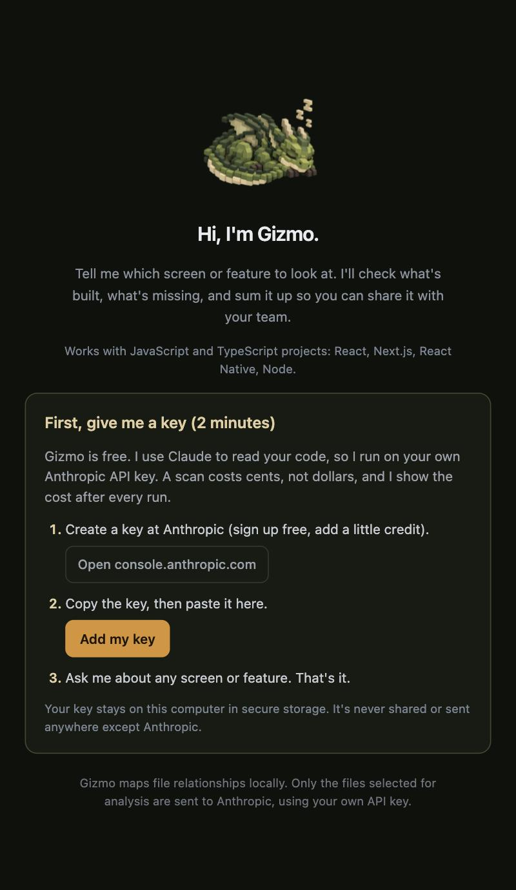
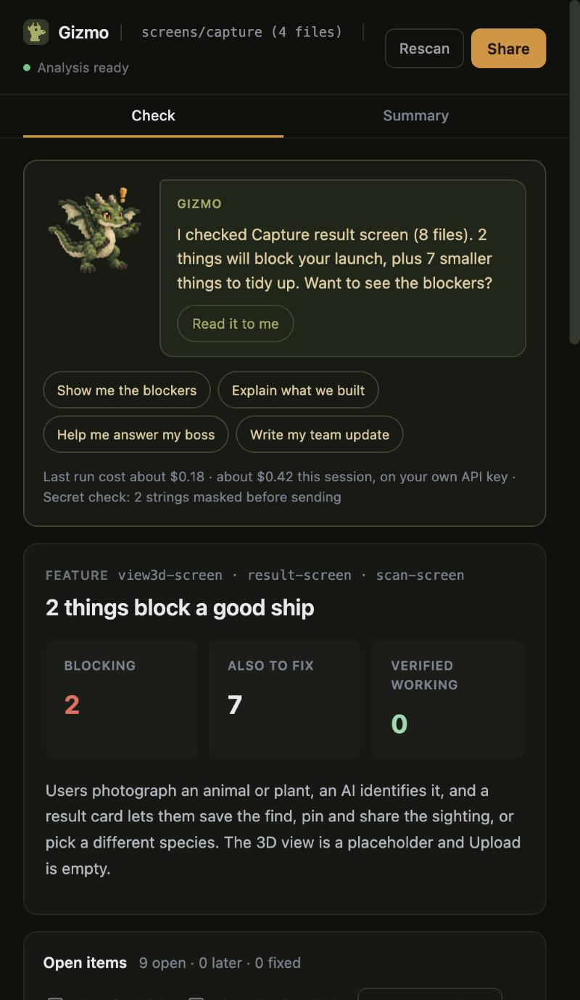
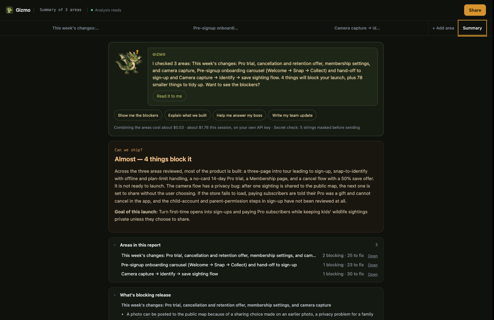

# Gizmo by Celestial Works

**Gizmo checks what you built with AI, sums it up in plain words, and helps you share it with your team.**

If you build with AI coding tools and also carry the designer, PM, or founder hat, you know the feeling: the code exists, but is it actually done? What's missing? What do I tell the team? Gizmo answers those three questions inside VS Code or Cursor, without you reading the code.

  
  
  

## What Gizmo does

Gizmo is a friendly block dragon who reads the screen or feature you point him at and tells you, in one line, where you stand. Then he gives you the details only if you want them.

**One area at a time, one tab each**

- Type a screen or feature, or tap one of your project's areas, and Gizmo scans it straight away. One screen or feature at a time (an "area"), so each scan stays fast, cheap, and reliable.
- **What I changed this week:** one tap reviews the code you changed in the last 7 days, the "what did I do this week?" your boss asks about.
- Want more? **+ Add area** scans the next one and gives it its own tab. Up to 4 areas per report.
- Everything you add is combined into one **Summary** for your team.

**Check (each area's tab): is what I built correct and complete?**

- A verdict up top: what blocks a launch, what's also worth fixing, and what's verified working.
- Open items you can check off, push to later, or dismiss as "not an issue." Every item links to the exact file and lines.
- A UX state audit (Loading, Empty, Error, Success, Disabled), what's working, and a requirements check against your own list.

**Summary: what do I tell my team?**

- "Can we ship?" across every area, in plain language, what's blocking release in each area, and recommended priorities.
- A ready-to-paste team update. One button copies it, or opens it in email. It reads as your own words.

**Ask Gizmo**

- Ask anything about what you built and get a short, plain-language answer, with Read it to me, Copy and Open in email.
- "Help me answer my boss": paste their message and pick who's asking (a boss or client gets plain words, a CTO or engineer gets the details). Gizmo drafts a reply from what's actually built, and you decide whether to send it.
- "Read it to me": Gizmo reads his notes and answers aloud in a British voice (on a Mac, Daniel, which comes with macOS). On a Mac, press Fn twice to talk instead of type.

Every claim is marked Confirmed (visible in the code), Likely (a reasonable inference), or Unclear (cannot be verified from these files). Gizmo is told never to invent screens, states, or permissions.

## Getting started (about 2 minutes)

1. Install Gizmo from the [VS Code Marketplace](https://marketplace.visualstudio.com/items?itemName=celestialworks.gizmo) (or [Open VSX](https://open-vsx.org/extension/celestialworks/gizmo) for Cursor), then open a JavaScript or TypeScript project (React, Next.js, React Native, Node).
2. Open the panel (Command Palette → **Gizmo: Open Panel**). Gizmo walks you through adding an Anthropic API key: create one at [console.anthropic.com](https://console.anthropic.com/settings/keys), add a little credit, paste it in. The key stays on your computer.
3. Ask about a screen or feature, or right-click a file or folder → **Gizmo: Explain as Product**. To add another area later, use **+ Add area** in the panel or right-click → **Gizmo: Add to Report**.

Gizmo is free. Each scan or question uses your own Anthropic credit: usually well under a dollar per area and cents per question. Gizmo shows the estimated cost before a scan and the actual cost after it, and never retries on its own.

## Good to know

- Works with JavaScript and TypeScript projects. Other languages are on the list for later.
- One area is up to 6 files and about 60,000 characters of code. If you pick more, Gizmo asks you to pick fewer before anything is sent, so you are never charged for a scan that is too big.
- Open items and chat live in the panel for the current analysis. Rescan keeps what you've checked off or dismissed.

## Privacy and safety

Gizmo runs entirely inside your editor. There is no Gizmo server, no account, no sign-up, and no analytics.

The short version: **everything Gizmo analyzes goes to Anthropic (the makers of Claude) and nowhere else, using your own API key.** If you'd rather not send code to Anthropic, Gizmo isn't for you, and that's fine.

Before the first analysis it shows this notice and asks you to confirm:

> Gizmo sends the selected code (plus a little related code it imports) to Anthropic, using your own API key, to write the review. .env and key files are never sent, and anything that looks like a secret inside code is masked first. Nothing else leaves your computer.

**What leaves your computer, and where it goes**

- Only the files you pick, or the files Gizmo matches to the screen, feature, or chip you choose (for "What I changed this week": your most recently changed source files, up to one scan's worth), plus a limited amount of code they import, go to Anthropic's API, and only when you run a scan, a question, or a spec comparison.
- A whole-product scan also sends a local inventory of your project: file names, folder structure, and screen or component names. Never the source of files that aren't selected.
- Requests go only to `api.anthropic.com`, over your own API key. Gizmo ignores proxy or token environment variables, so nothing can quietly reroute it. If Anthropic's safety filter declines a request, it may retry on another Anthropic model; it never goes to a third party.
- Your use of the API is covered by [Anthropic's terms and privacy policy](https://www.anthropic.com/legal/privacy), not by Gizmo.

**What never leaves your computer**

- Your API key. It lives in VS Code's Secret Storage (your OS keychain), never in settings, files, or logs.
- `.env*` files, key or certificate files, anything named like `credentials` or `secret`, `node_modules`, build output, binaries, and anything in your `.gitignore`.
- Strings inside code that look like keys are replaced with `[REDACTED]` before sending: known formats (Anthropic, OpenAI, Stripe, AWS, Google, GitHub, Slack, JWTs, private key blocks), quoted `apiKey:`/`secret:`/`password:` values, and any long random-looking string in quotes, whatever its format. The panel shows how many strings were masked after each scan.
- The project map, your open items, and chat history. They stay in VS Code's local storage for this workspace.
- Logs (View → Output → Gizmo) contain counts, durations, and error categories only. Never code, prompts, questions, or keys.

**Other safety notes**

- Gizmo only runs in trusted workspaces (it stays off in VS Code's Restricted Mode).
- Export brief and Export tickets write a file only where you choose in the save dialog.
- Gizmo treats everything in your code as data, not instructions. A comment that tries to steer the review is ignored and flagged as a risk.
- Gizmo is an independent project by Celestial Works and is not affiliated with or endorsed by Anthropic. Claude is a trademark of Anthropic, PBC. Provided as-is under the MIT License, without warranty.

## Commands

- **Gizmo: Open Panel**
- **Gizmo: Ask About This Product** — ask a question, Gizmo finds the files
- **Gizmo: Explain as Product** — also in the Explorer right-click menu; supports multi-select
- **Gizmo: Scan Whole Product** — a release review of the whole app
- **Gizmo: Analyze a User Flow** — pick files or a folder, then describe the flow to trace
- **Gizmo: Ask About Selection**
- **Gizmo: Compare to Spec**
- **Gizmo: Export Product Brief** and **Gizmo: Export Jira-Ready Tickets** — Markdown files, saved where you choose
- **Gizmo: Refresh Project Map** — rebuild the local file map
- **Gizmo: Configure AI Provider** — add, replace, or remove your API key
- **Gizmo: Clear Current Analysis**

## Settings

| Setting | Default | Description |
| --- | --- | --- |
| `gizmo.model` | `claude-opus-5-5` | Claude model used for analysis |
| `gizmo.maxFiles` | `12` | Max files per analysis |
| `gizmo.maxContextSize` | `160000` | Max total characters sent |
| `gizmo.includeRelatedImports` | `true` | Follow local imports of the selected file |
| `gizmo.importDepth` | `1` | How many import levels to follow |
| `gizmo.showPrivacyDisclosure` | `true` | Show the privacy disclosure before the first analysis |

## Troubleshooting

- **"No Anthropic API key is configured"** — click **Add my key** in the panel, or run *Gizmo: Configure AI Provider*.
- **"The AI provider rejected the API key"** — the key is invalid or revoked; create a new one and add it again.
- **"Your Anthropic account has no API credit left"** — add credit under Billing at console.anthropic.com, then try again.
- **"Claude is busy right now"** — wait a minute and try again.
- **"This file type is not supported yet"** — pick a `.ts/.tsx/.js/.jsx` file, or a folder containing them.
- **"The selection is too large"** — pick a smaller folder, or raise `gizmo.maxContextSize`.
- **The panel is blank** — check the Gizmo output channel (View → Output → Gizmo).

## What's next

Ideas on the list, in rough order: replies from your boss arriving straight from Slack or email, a custom voice for Gizmo, more languages beyond JavaScript and TypeScript, and other AI providers.

## About

Gizmo is made by Pauline Shay, a product designer who builds with AI, under Celestial Works. It started as a question she kept asking herself while wearing the designer, PM, and engineer hats at once: "Is this actually done, and how do I tell everyone?"

Portfolio: [hipauline.com](https://hipauline.com) · LinkedIn: [linkedin.com/in/hipauline](https://www.linkedin.com/in/hipauline)

Source code: [github.com/hipauline-shay/gizmo](https://github.com/hipauline-shay/gizmo). MIT License.
